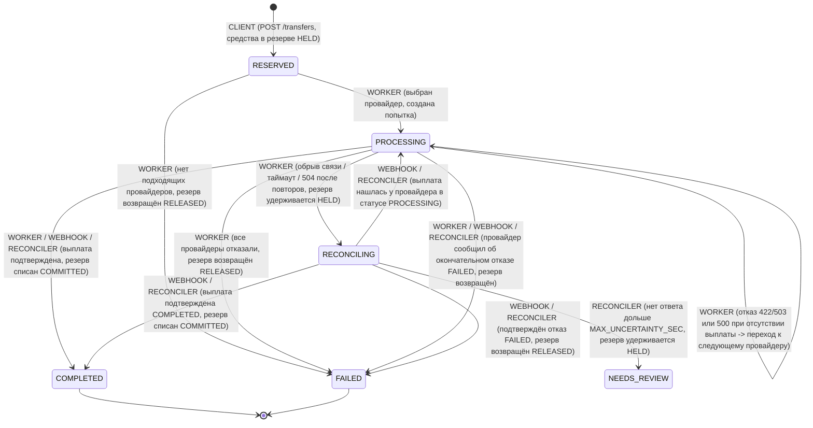

# Архитектурные решения (DECISIONS)

## 1. Стек, работа с деньгами и сохранность балансов

- **Python 3.12, FastAPI и синхронный пул соединений `psycopg 3`**. Работа с переводами строится вокруг коротких транзакций и строковых блокировок в PostgreSQL (`SELECT ... FOR UPDATE`), а обращение к внешним провайдерам вынесено в фоновые рабочие потоки (`ThreadPoolExecutor`). Синхронные обработчики FastAPI также выполняются в пуле потоков, поэтому код работы с базой остаётся прямым и наглядным, без риска случайно заблокировать асинхронный цикл событий.
- **Никаких `float` для денег**. Все расчёты в коде идут через `Decimal`, а в базе суммы хранятся в типе `NUMERIC(20, 4)` (курсы — в `NUMERIC(20, 8)`). В `app/money.py` описан неизменяемый класс `Money`: он не даёт складывать разные валюты и не позволяет создать сумму с лишними знаками после запятой в обход единой функции округления `round_money()`.
- **Проверка сходимости баланса прямо в базе данных**. В таблице `client_balances` задано ограничение:
  ```sql
  CHECK (available >= 0 AND reserved >= 0 AND debited >= 0
         AND available + reserved + debited = initial_balance)
  ```
  Даже если в коде допустить ошибку, сама база данных не позволит увести счёт в минус или нарушить правило `доступно + в резерве + списано = стартовый баланс`. Параллельные запросы от одного клиента выстраиваются в очередь блокировкой его строки в таблице `clients` (`SELECT ... FOR UPDATE`).

---

## 2. Асинхронное создание перевода (`202 Accepted`) и что видит клиент при 30-секундном ответе провайдера

Вместо того чтобы заставлять клиента ждать ответа внешнего провайдера в рамках одного HTTP-запроса, выбран **асинхронный подход с быстрым ответом `202 Accepted`**:

1. При вызове `POST /transfers` сервис проверяет котировку и суточный лимит, блокирует деньги на счёте клиента, сохраняет перевод в статусе `RESERVED` (`reserve_state = "HELD"`), передаёт задачу в фоновый обработчик и сразу отвечает клиенту за несколько миллисекунд.
2. Держать пользовательское соединение открытым 30 секунд ненадёжно: мобильное приложение, браузер или промежуточный прокси-сервер часто обрывают ожидание через 10–15 секунд. В таком случае клиент не получил бы `transfer_id` и отправил бы запрос повторно.

### Что видит клиент, если провайдер отвечает 30 секунд (сценарий `slow`)

1. **Сразу после отправки `POST /transfers` (`0 с`)**: клиент получает код `202 Accepted`, идентификатор `transfer_id`, статус `"RESERVED"` и состояние резерва `"HELD"`. В `GET /clients/{id}/balance` сумма уже перенесена из `available` в `reserved`.
2. **Во время ожидания провайдера (`0..30 с`)**: фоновый поток отправил запрос провайдеру и ждёт ответа (таймаут клиента задан с запасом — `32 с`). Опрашивая `GET /transfers/{transfer_id}`, клиент видит:
   - текущий статус `"PROCESSING"`, резерв `"HELD"`, выбранного провайдера в `active_provider_id`;
   - историю переходов статуса (`None -> RESERVED` от клиента `CLIENT`, `RESERVED -> PROCESSING` от фонового обработчика `WORKER`);
   - запись попытки в списке `attempts` со статусом `SENDING` (а когда провайдер ответит `201 PROCESSING` — со статусом `ACCEPTED` и номером выплаты `payout_id`).
   Если в это время клиент повторит `POST /transfers` с тем же `Idempotency-Key`, он снова получит `202 Accepted` и текущее состояние того же самого перевода — второй раз деньги не спишутся.
3. **После завершения выплаты (`> 30 с`)**: от провайдера приходит подписанное уведомление `COMPLETED` (либо завершение обнаруживает фоновая сверка). В `GET /transfers/{transfer_id}` клиент видит итоговый статус `"COMPLETED"` и состояние резерва `"COMMITTED"` (деньги окончательно перешли из резерва в списанные). Повторный `POST /transfers` с тем же ключом идемпотентности теперь возвращает `200 OK` с готовым результатом.

---

## 3. Схема состояний перевода (State Machine)

### Диаграмма переходов



### Таблица переходов и их инициаторов

Каждый переход сохраняется в таблице `transfer_transitions` с пометкой, кто именно его вызвал:
- `CLIENT` — запрос клиента;
- `WORKER` — фоновый поток отправки выплаты;
- `WEBHOOK` — входящее уведомление от провайдера;
- `RECONCILER` — периодическая фоновая задача сверки.

| Откуда | Куда | Кто вызывает | Когда происходит | Что с резервом |
|---|---|---|---|---|
| `None` | `RESERVED` | `CLIENT` | Успешный `POST /transfers`, деньги заблокированы на счёте | `HELD` |
| `RESERVED` | `PROCESSING` | `WORKER` | Выбран провайдер, в БД сохранена попытка `SENDING` перед сетевым вызовом | `HELD` |
| `RESERVED` | `FAILED` | `WORKER` | Ни один провайдер не подошёл по условиям или марже (`NO_ELIGIBLE_PROVIDER`) | `RELEASED` |
| `PROCESSING` | `PROCESSING` | `WORKER` | Провайдер явно отказал (`422`/`503`) или вернул `500`, а проверка подтвердила `404` — переход к запасному провайдеру | `HELD` |
| `PROCESSING` | `RECONCILING` | `WORKER` | Связь оборвалась / истёк таймаут / получен `502` или `504` — судьба выплаты неизвестна, переключение запрещено | `HELD` |
| `PROCESSING` | `COMPLETED` | `WORKER` / `WEBHOOK` / `RECONCILER` | Провайдер подтвердил выплату сразу, уведомлением или при сверке | `COMMITTED` |
| `PROCESSING` | `FAILED` | `WORKER` / `WEBHOOK` / `RECONCILER` | Все доступные провайдеры отказали либо принявший провайдер сообщил финальный `FAILED` | `RELEASED` |
| `RECONCILING` | `PROCESSING` | `WEBHOOK` / `RECONCILER` | Выплата появилась у провайдера в статусе `PROCESSING` (прошла задержка обновления у провайдера) | `HELD` |
| `RECONCILING` | `COMPLETED` | `WEBHOOK` / `RECONCILER` | Уведомление или сверка подтвердили успешную выплату `COMPLETED` | `COMMITTED` |
| `RECONCILING` | `FAILED` | `WEBHOOK` / `RECONCILER` | Уведомление или сверка подтвердили отказ в выплате `FAILED` | `RELEASED` |
| `RECONCILING` | `NEEDS_REVIEW` | `RECONCILER` | За `MAX_UNCERTAINTY_SEC` статус у провайдера так и не удалось выяснить | `HELD` (остаётся в резерве до ручного разбора) |

Статусы `COMPLETED` и `FAILED` — конечные (терминальные). После перехода в них повторные или запоздавшие уведомления уже не могут поменять статус перевода или повторно изменить баланс клиента.

---

## 4. Защита от двойных выплат при сбоях (Level 3)

Главный принцип: **если мы не знаем наверняка, принял ли провайдер запрос, нельзя ни возвращать деньги клиенту, ни отправлять эту же выплату другому провайдеру**.

1. **Фиксация попытки до обращения в сеть**. Прежде чем отправить HTTP-запрос `POST /{provider_id}/payouts`, рабочий поток сохраняет в таблицу `provider_attempts` запись в статусе `SENDING` и закрепляет за ней постоянный ключ `idempotency_key = "{transfer_id}:{provider_id}"`.
2. **Повторные запросы к тому же провайдеру с тем же ключом**. Если сеть оборвалась или вернулась ошибка `5xx`, поток делает 3 коротких повтора (`0.15 с`, `0.30 с`, `0.50 с`) к **этому же** провайдеру с **тем же самым** `Idempotency-Key`. Если первый запрос всё-таки успел дойти, провайдер по ключу идемпотентности вернёт уже созданную выплату, а не создаст вторую.
3. **Когда можно безопасно перейти к следующему провайдеру**:
   - провайдер вернул явный отказ в приёме заявки (`400`, `404`, `409`, `422`, `503`) — выплата точно не создана;
   - провайдер вернул чистую внутреннюю ошибку `500` (без обрывов связи), и контрольный запрос `GET /{provider_id}/payouts?reference={transfer_id}` явно ответил `404`.
4. **Когда переходить к другому провайдеру нельзя (`RECONCILING`)**. Если хотя бы одна попытка закончилась обрывом соединения, таймаутом, `502` или `504`, то даже ответ `404` при проверке ещё ничего не гарантирует: у провайдера может быть задержка отображения только что созданной выплаты (`visibility_lag` в режиме `chaos`). В этом случае перевод переходит в статус `RECONCILING`, резерв остаётся заблокированным (`HELD`), а фоновая сверка опрашивает этого провайдера до получения точного ответа. Если за `45 с` ясности так и не появилось, перевод получает явный статус «требует проверки» (`NEEDS_REVIEW`) с сохранённым резервом.
5. **Падение сервиса посреди отправки**. Если процесс внезапно завершился после отправки запроса провайдеру, но до записи ответа в БД, при следующем запуске метод `recover_incomplete()` находит попытки в состоянии `SENDING` и повторяет вызов к тому же провайдеру с сохранённым `idempotency_key`.

---

## 5. Выбор провайдера и правило минимальной маржи

### Предварительный отсев

В модуле `app/routing.py` провайдер допускается к участию в выборе только при одновременном выполнении четырёх условий:
1. Он работает с нужным направлением (`direction_id`).
2. Он включён (`enabled == true`) и сейчас у него не идут технические работы из списка `maintenance_windows` (так отсеиваются выключенный `prov_delta` и находящийся на обслуживании `prov_echo`).
3. Сумма выплаты `target_amount` в пересчёте на валюту провайдера укладывается в его границы `[limits.min, limits.max]`.
4. Маржа компании на этом переводе не ниже минимального порога направления `min_margin_percent`:
   $$\text{margin\_percent} = \frac{\text{client\_fee\_in\_source} - \text{provider\_fee\_in\_source}}{\text{source\_amount}} \times 100\% \ge \text{min\_margin\_percent}$$

### Как взвешиваются надёжность, выгода и скорость

Каждому подходящему провайдеру начисляется итоговый балл от `0` до `1`:

$$\text{score} = 0.50 \cdot \text{reliability} + 0.35 \cdot \text{margin\_score} + 0.15 \cdot \text{latency\_score}$$

где:
- $\text{reliability} = \text{success\_rate\_24h}$ — доля успешных выплат за последние сутки (от `0` до `1`);
- $\text{margin\_score} = \frac{\min(\max(\text{margin\_percent}, 0), 3.0)}{3.0}$ — оценка маржи (ограничена сверху значением `3.0%`, чтобы слишком дешёвый, но ненадёжный провайдер не выходил на первое место только за счёт низкой цены);
- $\text{latency\_score} = \frac{1}{1 + \text{p95\_latency\_ms} / 2000}$ — оценка скорости ответа (`1.0` при мгновенном ответе, `0.5` при задержке `2000 мс`).

**Обоснование весов `0.50 / 0.35 / 0.15`:**
- **Надёжность (`0.50`)** важнее всего: сбои и отказы провайдера задерживают перевод клиента и требуют повторных попыток или сверки. Благодаря этому весу дешёвый, но проблемный `prov_bravo` (комиссия `0.10%`, но успех всего `0.62`) уступает стабильным `prov_alpha` (`0.97`) и `prov_charlie` (`0.95`) и остаётся лишь последним запасным вариантом.
- **Маржа (`0.35`)** позволяет среди надёжных провайдеров выбрать того, с кем компания зарабатывает больше.
- **Скорость ответа (`0.15`)** служит дополнительным критерием при близких надёжности и цене: разница в секунду на этапе приёма заявки не критична для банковского перевода, тем более что клиент не ждёт ответа синхронно.

### Можно ли брать запасным провайдера с маржой ниже `min_margin_percent`?

**Наше решение: нет (`allow_below_min_margin = False`).**

Даже если основной провайдер отказал, сервис не выбирает запасного провайдера, у которого маржа ниже допустимого минимума тарифа (например, в справочнике есть `prov_golf` с отличной надёжностью `0.999`, но высокой комиссией `1.90% + 0.300 KWD` при клиентском тарифе `0.90%`, что даёт прямой убыток на операции).

Если разрешить автоматический уход к убыточному провайдеру, любая поломка основного партнёра приведёт к тому, что сервис начнёт массово проводить переводы себе в минус. Честнее и безопаснее завершить такой перевод со статусом `FAILED` и сразу разблокировать деньги клиента.

---

## 6. Использование ИИ-инструментов и где ИИ ошибся

### Какие инструменты использовали и для чего

При разработке в режиме парного программирования использовался ИИ-ассистент (**Antigravity**) вместе со встроенными проверками кода в редакторе (Ruff и Pylance):
- обсуждение структуры модулей, схемы таблиц БД и крайних случаев при сетевых сбоях;
- написание шаблонного кода обработчиков FastAPI, SQL-запросов и заготовок для тестов;
- подготовка набора модульных и многопоточных интеграционных тестов.

Все расчётные правила, переходы состояний и логику работы с резервом мы разбирали вручную и проверяли тестами.

### Где ИИ ошибся и как мы это заметили

1. **Округление комиссии клиента вниз (`ROUND_DOWN`) дало расхождение в 1 копейку в режиме `TARGET` (`299899.99` вместо `299900.00`).**
   - *В чём была ошибка:* изначально ИИ предложил округлять вниз (`ROUND_DOWN`) вообще все расчётные величины — не только сумму выплаты получателю, но и комиссию клиента.
   - *Как заметили:* при прогоне тестов по проверочным примерам из папки `examples/` упал пример `03_target_mode.json` (направление `RU-TH-BANK`, получатель ждёт `124068.63 THB`, комиссия `1.5%`). Наш расчёт вернул `source_amount = 299899.99 RUB`, тогда как в эталонном ответе ожидалось `299900.00 RUB`.
   - *Как разобрались и исправили:* при сумме `299899.99 RUB` точная комиссия `1.5%` составляет `4498.49985`. При округлении вниз она превращалась в `4498.49`, давая клиенту скидку в 1 копейку, после чего `(299899.99 - 4498.49) * 0.42 = 295401.50 * 0.42 = 124068.63 THB`. Так как комиссия вычитается из суммы отправителя (`S - fee`), чтобы остаток не округлялся в ущерб сервису, саму комиссию нужно округлять **вверх** (`FEE_ROUNDING = ROUND_CEILING`), а итоговую выплату — **вниз** (`PAYOUT_ROUNDING = ROUND_DOWN`). После разделения этих двух правил в `app/money.py` все примеры из `examples/` полностью сошлись.

2. **Сортировка попыток по `(created_at, attempt_id)` перепутала порядок обхода провайдеров.**
   - *В чём была ошибка:* при выборке попыток из таблицы `provider_attempts` ИИ написал `ORDER BY created_at ASC, attempt_id ASC`, где `attempt_id` — случайный идентификатор `att_...`.
   - *Как заметили:* упал интеграционный тест на переключение между провайдерами (`test_scenario_decline_and_error_5xx_failover_and_release_when_all_fail`) — в ответе `GET /transfers/{id}` попытки вернулись в порядке `['prov_charlie', 'prov_bravo', 'prov_alpha']`, хотя сервис вызывал их строго по убыванию оценки `alpha -> charlie -> bravo`.
   - *Как исправили:* при быстрых локальных отказах (и фиксированном времени в тесте) у нескольких записей совпала метка `created_at`, и база отсортировала их по случайной строке `attempt_id`. Мы добавили в таблицу порядковый счётчик `seq BIGSERIAL` (`migrations/003_transfer_scenario.sql`) и заменили сортировку на `ORDER BY seq ASC`.

3. **Несовместимость строкового SQL с проверкой типов в `psycopg 3` и устаревшая аннотация `@asynccontextmanager`.**
   - *В чём была ошибка:* в модуле запуска миграций `app/db.py` ИИ прочитал SQL-файл через `path.read_text()` (тип `str`) и передал в `conn.execute()`, а функцию жизненного цикла `lifespan` в `app/main.py` пометил возвращаемым типом `AsyncIterator[None]`.
   - *Как заметили:* анализатор типов Pylance в редакторе показал ошибку на `conn.execute()` (библиотека `psycopg 3` принимает в виде `str` только строковые литералы `LiteralString` для защиты от SQL-инъекций) и зачеркнул декоратор `@asynccontextmanager` как устаревший вариант вызова.
   - *Как исправили:* заменили чтение файла миграции на `path.read_bytes()` (байтовые строки `bytes` официально разрешены типом `psycopg.abc.Query`), а тип `lifespan` уточнили до `AsyncGenerator[None, None]`.
